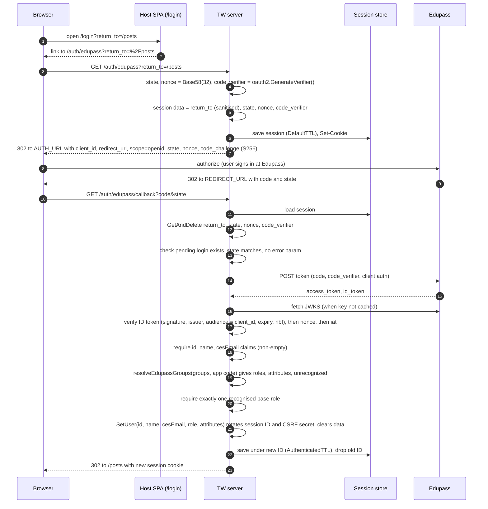
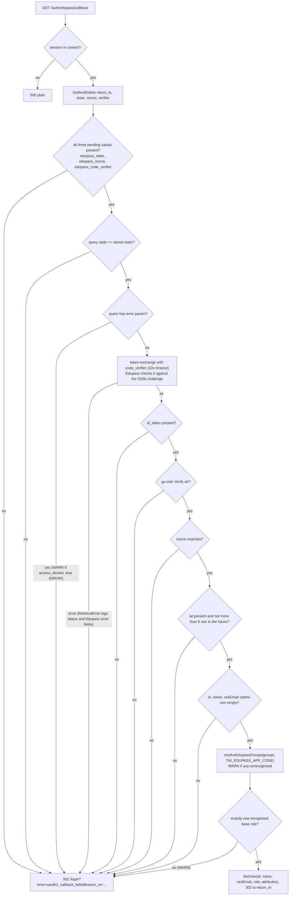
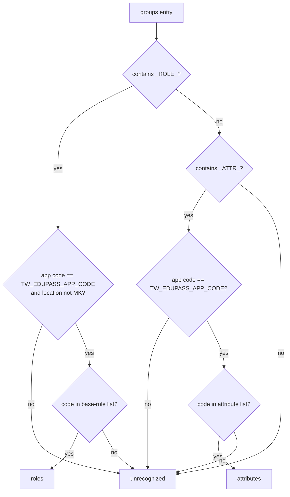

# Workflow: Sign in with Edupass

Revision: `main` @ `abe5457` (synced from `5ff58a7` on 2026-10-16; covers #199, #200, #202, #205, #211). Phase 2/3, batch 3 (2026-10-09).

Files in scope: `server/internal/handler/auth.go` (read in full), `server/internal/handler/auth_test.go` (case names reviewed, a few bodies sampled), `server/internal/config/config.go` (`EdupassAppCode`, `EdupassConfig.validate`), `apps/mock-edupass/src/provider.ts` and `src/config.ts` (read in full), `apps/mock-edupass/test/api.test.ts` (case names reviewed), `apps/host/src/containers/LoginView.tsx` (read in full). Session mechanics are in `../subsystems/sessions.md`.

## 1. Summary

Teacher Workspace (TW) is an OIDC **relying party** of Edupass, MOE's identity provider. It uses the **authorization code flow with PKCE (S256)**, a `state` and a `nonce`, and authenticates itself at the token endpoint with either `client_secret_post` or `private_key_jwt` (PS256 client assertion with an `x5t#S256` certificate thumbprint). After verifying the ID token (including an `iat` check TW adds itself), it requires the `id`, `name` and `cesEmail` claims, **resolves the `groups` claim into exactly one base role plus zero or more attributes**, and stores all of these in the session. A user without exactly one recognised base role for TW's app code is refused.

There is no sign-out, no token refresh, and the access token and ID token are discarded after sign-in.

## 2. Actors and endpoints

| Actor / endpoint | Role | Evidence |
| --- | --- | --- |
| Host SPA `/login` (`LoginView`) | "Sign in with Edupass" link to `/auth/edupass?return_to=...`; shows an error toast when `?error=oauth2_callback_failed` | `LoginView.tsx:8-35` |
| `GET /auth/edupass` (`Handler.authEdupass`) | Start: create pending login, redirect to Edupass | `auth.go:29-64`, route `handler.go:95` |
| `GET /auth/edupass/callback` (`Handler.authEdupassCallback`) | Finish: validate, exchange code, verify ID token, resolve groups, sign in | `auth.go:66-291`, route `handler.go:96` |
| Edupass authorize endpoint | `TW_EDUPASS_AUTH_URL` (mock: `/authorize`) | `handler.go:49-50`, `provider.ts:137` |
| Edupass token endpoint | `TW_EDUPASS_TOKEN_URL`, called server to server with a 10s timeout | `handler.go:41, 51`, `auth.go:142-202` |
| Edupass JWKS | `TW_EDUPASS_JWKS_URL`, fetched by go-oidc's remote key set | `handler.go:56-63` |

## 3. Happy path

| Step | Status | Evidence |
| --- | --- | --- |
| Steps 4-5: random values and session keys | Verified | `auth.go:48-55`, keys `auth.go:22-27` |
| Step 7: auth URL params (`client_id`, `redirect_uri`, `scope=openid`, `state`, `nonce`, S256 challenge) | Verified | `auth.go:57-61`, `handler.go:46-55`; tests `auth_test.go:79-169` |
| Steps 6, 22-23: session save, rotation, cookie | Verified | `middleware/session.go`, see `../subsystems/sessions.md` |
| Step 12: single-use pending login (deleted before validation) | Verified | `auth.go:95-113` |
| Steps 14-15: token request | Verified | `auth.go:142-202`; tests `auth_test.go:431, 1400-1916` |
| Step 17: ID token checks: signature, issuer, audience, expiry, `nbf` done by go-oidc `Verify` | Inferred (library behaviour; `nbf` has a test, `auth_test.go:587`); nonce and `iat` checks Verified | `handler.go:56-63`, `auth.go:211-234` |
| Step 18: `id`, `name`, `cesEmail` required | Verified | `auth.go:236-261`; tests `auth_test.go:872-1085` |
| Steps 19-20: group resolution and the one-base-role rule | Verified | `auth.go:263-279`, `resolveEdupassGroups` `auth.go:452-489`; tests `auth_test.go:1916-2151, 2381-2710` |
| Step 21: identity, role and attributes stored | Verified | `auth.go:281-287` |
| Login is logged without the email | Verified | `auth.go:289`; test `auth_test.go:1154` |

## 4. Client authentication at the token endpoint

| Method | What TW sends | Evidence |
| --- | --- | --- |
| `client_secret_post` (default) | `client_id` (form body, `AuthStyleInParams`), `client_secret`, `code`, `code_verifier` | `auth.go:168-170`, `handler.go:53` |
| `private_key_jwt` | `client_assertion_type=urn:ietf:params:oauth:client-assertion-type:jwt-bearer`, `client_assertion` = PS256 JWT with `iss` and `sub` set to the client ID, `aud` = token URL, random `jti` (Base62(32)), `iat` = `nbf` = now, `exp` = now + 5 min; header `x5t#S256` = base64url SHA-256 of the certificate | `auth.go:144-167`, thumbprint built in `config.go:435-438`; tests `auth_test.go:1444-1916` |

Since #211 both methods build a shared `[]oauth2.AuthCodeOption` (the PKCE verifier first, then the method's own params) and make a single `Exchange` call through `oidc.ClientContext(r.Context(), h.edupassHTTPClient)` (`auth.go:142-173`).

The mock README says real Edupass requires `private_key_jwt`; the mock accepts a client assertion only when it is PS256 and its `x5t#S256` matches the registered certificate (`provider.ts:99-121`).

## 5. Callback validation and failure paths

Every failure redirects to the login page with the sanitised `return_to`, so the user can retry and still land where they wanted (`auth.go:325-332`, `LoginView.tsx:14-16`). Because the pending login is deleted first, a replayed callback always fails (doc comment `auth.go:81-82`).

| Failure branch | Test case present? | Evidence |
| --- | --- | --- |
| No session (500) | yes | `auth_test.go:380, 401` |
| Token endpoint rejects client / code; no ID token; timeout | yes | `auth_test.go:485-548` |
| ID token `nbf` in the future; `iat` missing or more than 5 min in the future (and the within-skew pass case) | yes | `auth_test.go:587-803` |
| Missing `id`, `name` or `cesEmail` | yes | `auth_test.go:872-1014` |
| Groups: empty, no recognised base role, more than one, only base role at an MK school | yes | `auth_test.go:2063-2116` |
| Logging of failed token responses (fields, non-JSON body, no secret, no assertion) | yes | `auth_test.go:1298, 1360, 1544` |
| No pending login, state mismatch, `error` param, ID token signature/issuer failure, nonce mismatch, claims unmarshal failure | **no case names cover these** | `auth_test.go` case list; worth adding (Q25) |

## 6. `return_to` safety (`safeReturnTo`)

Accepted only if it is at most 1024 bytes, starts with `/` but not `//` or `/\`, parses as a URL, has no backslash in the decoded path, and has no `.` or `..` path segment; otherwise `/` (`auth.go:293-323`). It is applied when the login starts (`auth.go:52`); the callback trusts the stored value. Tests cover protocol-relative, encoded protocol-relative, backslash variants, encoded and partly encoded dot-dot, control characters, CRLF injection and length (`auth_test.go:2203-2380`).

## 7. Identity data: what Edupass sends vs what TW keeps

| Claim      | Sent (per mock)                                                  | Kept by TW                                      |
| ---------- | ---------------------------------------------------------------- | ----------------------------------------------- |
| `sub`      | yes (same value as `id` in the mock)                             | no                                              |
| `iat`      | yes                                                              | no, but checked (present, not > 5 min ahead)    |
| `nbf`      | yes                                                              | no, checked by go-oidc                          |
| `id`       | yes                                                              | **`User.ID`** (required)                        |
| `name`     | yes                                                              | **`User.Name`** (required)                      |
| `cesEmail` | omitted when the account has none (staff-8)                      | **`User.Email`** (required)                     |
| `groups`   | always present, possibly empty                                   | resolved into **`User.Role`** and **`User.Attributes`** |
| `email`    | no longer emitted by the mock; not read by TW                    | no                                              |

Evidence: claims struct and checks `auth.go:236-261`, `SetUser` `auth.go:281-287`, mock claims `provider.ts:126-127, 154-175`.

### 7.1 Group resolution (`resolveEdupassGroups`, `auth.go:452-489`)

Each `groups` entry is an Edupass app role named `<location_code>_<app_code>_<tw_role_code>`, where `tw_role_code` is `ROLE_<name>` (base role) or `ATTR_<name>` (attribute). For example `1234_TW_ROLE_TEACHER` is base role `ROLE_TEACHER` at location 1234, and `1234_TW_ATTR_CCE` is attribute `ATTR_CCE`.

- The entry is split on the `_ROLE_` or `_ATTR_` infix; the stored code keeps its `ROLE_`/`ATTR_` prefix and drops the location and app code (`codeAfterInfix`, `auth.go:493-496`).
- The part just ahead of the infix must end in `_<appCode>`, where `appCode` is `TW_EDUPASS_APP_CODE` (`TW` by default, `TWSTG` for pre-prod Edupass); otherwise the entry is unrecognised (`hasEdupassAppCode`, `auth.go:503-506`).
- The code must be in the allow-list: 22 base roles (`isRecognizedEdupassRole`, `auth.go:344-372`) and 9 attributes (`isRecognizedEdupassAttribute`, `auth.go:376-390`).
- A **base role** whose location code is a MOE Kindergarten (MK) school (`isMKSchoolCode`, `auth.go:396-408`, codes 6101-6159 except 6125) is treated as unrecognised, so MK staff cannot sign in. Attributes at MK schools still resolve, because sign-in is granted by a base role alone (doc comment `auth.go:445-449`).
- Anything else is reported in `unrecognized` (logged at WARN with `edupass_id`) without blocking sign-in.
- The caller refuses sign-in unless exactly one base role resolved (`auth.go:271-279`); more than one is treated as a conflict, never guessed.

Outcome per mock fixture (default `TW_EDUPASS_APP_CODE=TW`; derived from the code above and the fixture list, with the MK cases also covered by tests at `auth_test.go:2000, 2081`):

| Fixture | Groups | Outcome |
| --- | --- | --- |
| staff-1 | `0001_TW_ROLE_TEACHER`, `0001_TW_ATTR_PG_ADMIN` | signs in as `ROLE_TEACHER` with `ATTR_PG_ADMIN` |
| staff-2 | `1234_TW_ROLE_TEACHER` | signs in as `ROLE_TEACHER`, no attributes |
| staff-3 | `X_TW_ROLE_TEACHER`, `X_TW_ATTR_PG_ADMIN` | signs in (location is not checked except for MK) |
| staff-4 | two base roles at one location | refused (more than one base role) |
| staff-5 | `0001_TWSTG_ROLE_TEACHER` | refused unless `TW_EDUPASS_APP_CODE=TWSTG` |
| staff-6 | base roles at two schools | refused (more than one base role) |
| staff-7 | `X_TW_ROLE_TEACHER`, `X_XX_ROLE_COUNSELLOR` | signs in as `ROLE_TEACHER`; the `XX` entry is logged as unrecognised |
| staff-8 | empty groups, no `cesEmail` | refused (missing `cesEmail`, checked first) |
| staff-9 | `6101_TW_ROLE_TEACHER` | refused (only base role is at an MK school) |
| staff-10 | `6101_TW_ROLE_HOD`, `1234_TW_ROLE_TEACHER` | signs in as `ROLE_TEACHER` |

The resolved role and attributes are forwarded to remote app backends in the proxy JWT (`workflows/api-proxy.md`). This resolves the authorisation gap recorded as Q26 / security R3 for sign-in; remote apps still decide what each role may do.

## 8. Local development with mock-edupass

- The mock auto-completes login and consent with no UI and defaults to `staff-1` (`app.ts:15-56`).
- To sign in as another fixture, the authorize request needs `&account=staff-N` (`provider.ts:130`; matched against the account's `id`, `app.ts:21`). TW never adds it, so in practice append it to the Edupass URL in the browser's address bar after the redirect, before it loads (or copy the 302 `Location` and edit it). Fixtures run `staff-1` to `staff-10`; see section 7.1 and `apps/mock-edupass/README.md`.
- `staff-5` only signs in when TW runs with `TW_EDUPASS_APP_CODE=TWSTG` (`.env.example`).
- The mock generates a new signing key each boot (`provider.ts:86`); TW's remote key set refetches on an unknown `kid`, so restarting the mock while TW runs should be fine (Inferred, go-oidc behaviour).
- `provider.proxy = true` trusts `X-Forwarded-*` headers so it works behind a load balancer (`provider.ts:178`; test `api.test.ts`).
- mock-edupass tests are not run in CI (Q12).

## 9. Observations

| # | Observation | Status |
| --- | --- | --- |
| A1 | Edupass token error bodies carry `error_codes`, `timestamp`, `trace_id`, `correlation_id`. Since #211 TW logs them for **every** `oauth2.RetrieveError` (any status), as `edupass_error_codes`, `edupass_timestamp`, `edupass_trace_id`, `edupass_correlation_id`, next to `status`, `error_code` and `error_description`; a non-JSON body just leaves them empty. That shape matches Microsoft Entra ID error responses, suggesting Edupass is built on Entra | Verified fields (`auth.go:174-202`); Entra link Inferred |
| A2 | If Edupass returns an `error` without echoing `state`, TW logs "state mismatch" instead of the provider error, because the state check runs first | Verified order (`auth.go:117-140`) |
| A3 | TW reads `cesEmail`, not `email`, and checks no `email_verified`-style claim | Verified (claims struct `auth.go:236-241`) |
| A4 | No refresh token use and no stored ID token, so there is no silent re-auth after the 30m idle expiry and no `id_token_hint` for an Edupass logout | Verified (tokens go out of scope after `auth.go:281`) |
| A5 | The `switch` on client auth method has no `default`; an unknown method would send neither secret nor assertion. Unreachable because config validation rejects other values | Verified (`auth.go:143-170`, `config.go:441`) |
| A6 | Starting a login is a GET that changes session state. Harmless here (it only replaces a pending login), and `state` bound to the session prevents login CSRF on the callback | Verified |
| A7 | go-oidc's verifier skips `iat`, so TW checks it itself, allowing the same 5 minutes of clock skew go-oidc allows for `nbf` | Verified (comment and checks `auth.go:224-234`) |
| A8 | Every Edupass auth log line carries `provider=edupass` via `logger.With` (#205); the provider-error message is now "failed to get authorization code" | Verified (`auth.go:39, 86, 137`) |
| A9 | The role and attribute allow-lists and the MK school list are hard-coded; a new Edupass code, or a newly assigned MK school, needs a code change and release. Unknown codes are logged, not fatal | Verified (`auth.go:344-408`) |
| A10 | Location is not checked beyond the MK filter, and the stored role drops its location, so a user's school is not in the session | Verified (`codeAfterInfix`, `auth.go:493-496`) |

## 10. Where to change things

| Change | Where |
| --- | --- |
| Keep more identity (e.g. location, `sub`) | `claims` struct `auth.go:236-241`, `session.User` (`session.go:59-65`), `SetUser` call `auth.go:281-287` |
| Recognise a new base role, attribute or MK school | `isRecognizedEdupassRole`, `isRecognizedEdupassAttribute`, `isMKSchoolCode` (`auth.go:344-408`); add a `TestResolveEdupassGroups` case |
| Change the one-base-role rule | caller check `auth.go:271-279` (keep `resolveEdupassGroups` reporting every role) |
| Point at pre-prod Edupass | `TW_EDUPASS_APP_CODE=TWSTG` (`config.go:242-247, 336-339`) |
| Request more scopes | `Scopes` in `handler.go:54` |
| Change login error UX | `loginFailedURL` (`auth.go:325-332`) and `LoginView.tsx` |

Breakpoints: `auth.go:52` (start), `auth.go:104` (pending login check), `auth.go:173` (token exchange), `auth.go:211` (ID token verify), `auth.go:263` (group resolution), `auth.go:281` (sign in).
